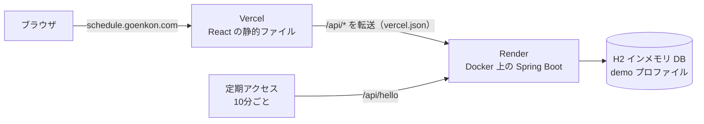

# シフト管理システム（Staff Scheduling System）

[English](README.md) · **日本語** · [中文](README.zh-CN.md)

焼肉店向けのシフト管理アプリです。店長は月のシフト表を自動作成して手動で調整し、従業員の管理と申請の対応を行います。従業員はログインしてシフトを確認し、休み・シフト交換などの申請を出せます。

フロントエンドは **React + TypeScript**、バックエンドは **Java 21 + Spring Boot** で作りました。

## デモ

**https://schedule.goenkon.com**

| 役割 | メールアドレス | パスワード |
|---|---|---|
| 店長 | `manager@demo.com` | `demo1234` |
| 従業員 | `staff@demo.com` | `demo1234` |

- デモ環境のデータベースはインメモリです。サーバーが再起動するたびにサンプルデータに戻るので、自由に追加・編集・削除して大丈夫です。
- バックエンドは Render の無料プランで動いています。無料プランはしばらくアクセスがないとスリープしますが、10 分ごとに定期アクセスして起こしたままにしています。この定期アクセスが止まった場合は、最初のリクエストに 30〜60 秒かかることがあります。

## 主な機能

**店長**
- **ダッシュボード**：従業員数、今日の出勤者、今日の休み、今月の総労働時間、未対応の申請
- **従業員管理**：追加・編集・削除（論理削除なので、過去のシフト表や申請には名前が残ります）
- **シフト自動作成**：翌月の正社員シフトを作成（厨房・ホールの1日の人数、除外する人を指定）。作成前に人数が足りるかを確認します
- **手動調整**：カレンダーの日付をクリックして入れ替えたり、アルバイトを追加したりできます。提出するまでは下書きとして保存されます
- **申請対応**：従業員の申請を確認し、対応済みにします

**従業員**
- 提出済みのシフト表の閲覧（閲覧のみ）
- 休み・シフト交換・その他の申請、自分の未対応の申請の取り消し

**その他**
- 画面は英語・日本語・中国語の3か国語に対応
- 権限はフロントとバック両方でチェック：画面では店長専用の操作を表示せず、バックエンドでも拒否します

## 技術スタック

| レイヤー | 技術 |
|---|---|
| フロントエンド | React 19、TypeScript、Vite、MUI、React Router |
| バックエンド | Java 21、Spring Boot 4、Spring Data JPA（Hibernate）、Bean Validation |
| 認証 | BCrypt によるパスワードのハッシュ化、JWT（Nimbus JOSE）、独自のインターセプター + `@ManagerOnly` アノテーション |
| データベース | MySQL 8.4（ローカル、Docker）／ H2 インメモリ（公開デモ） |
| デプロイ | Vercel（フロント）、Render + Docker（バック）、Cloudflare DNS |

## 構成



- フロントエンドは相対パス（`/api/...`）だけを呼び出します。ローカルでは Vite の開発サーバーが `localhost:8080` に、本番では Vercel が Render に転送します。ブラウザから見るとオリジンは1つだけなので、CORS の設定は不要です。
- 外部の定期実行サービスから 10 分ごとにヘルスチェック用の `/api/hello` にアクセスし、無料プランがスリープしないようにしています（そのため `/api/hello` はログイン不要にしています）。

## 設計のポイント

- **機能ごとのパッケージ構成**（`employee`、`auth`、`request`、`schedule`）。どのパッケージも Entity → Repository → DTO → Service → Controller の同じ形です。
- **名前ではなく ID を保存**：シフト表や申請は従業員を ID で参照するので、名前を変えるとすべてに反映されます。
- **入れ子のシフト表を行に平坦化**：1か月分（日 → 厨房／ホール／アルバイト → 昼／夜 → 人）を、保存時は `schedule_assignments` の行に分解し、取得時に組み立て直します。JSON でまとめて保存はしていません。
- **N+1 問題の解消**：`@EntityGraph` で関連データを1回のクエリで取得（51 本の SQL → 1 本）。
- **楽観ロック**：月のシフト表に `@Version` を使用。
- **クライアントの値を信用しない**：「ログイン中のユーザー」は必ず検証済みの JWT から取得します。従業員が取り消せるのは自分の未対応の申請だけです（それ以外は 403 / 409）。
- **バックエンドでの必須ルールのチェック**：日付の妥当性、部署と雇用形態の一致、同じシフトへの重複配置の禁止、アルバイトは1日1シフトまで。
- **デモ用プロファイル**：`application-demo.properties` でコードを変えずに MySQL を H2 に切り替えます。起動するたびに Seeder が従業員・アカウント・申請・今月のシフト表を作り直します。

## API（15 本）

| 分類 | エンドポイント |
|---|---|
| 認証 | `POST /api/auth/login` · `GET /api/auth/me` |
| 従業員 | `GET /api/employees` · `GET /api/employees/{id}` · `POST /api/employees` · `PUT /api/employees/{id}` · `DELETE /api/employees/{id}` |
| シフト表 | `GET /api/schedules?from=YYYY-MM&to=YYYY-MM` · `PUT /api/schedules/{YYYY-MM}` · `DELETE /api/schedules/{YYYY-MM}` |
| 申請 | `GET /api/requests/mine` · `GET /api/requests` · `POST /api/requests` · `PATCH /api/requests/{id}/status` · `DELETE /api/requests/{id}` |

従業員とシフト表の更新系、申請の全件一覧は店長のみ使えます。テーブル・項目・ステータスコードの詳細は [docs/api-design.md](docs/api-design.md)（中国語）にあります。

## ディレクトリ構成

```
schedule-system/
├── frontend/              React + TypeScript（Vite）
│   ├── src/api/           fetch のラッパー（トークン付与、401 の処理）
│   ├── src/auth/          ログイン状態
│   ├── src/data/          API 呼び出し + フロント側のシフト作成アルゴリズム
│   ├── src/pages/         ダッシュボード、シフト表、従業員、申請など
│   ├── src/components/    ダイアログ・共通コンポーネント
│   ├── src/i18n/          英語・日本語・中国語の文言
│   └── vercel.json        本番用の /api 転送設定
├── backend/               Spring Boot
│   ├── src/main/java/com/goenkon/schedule/
│   │   ├── auth/          アカウント、ログイン、JWT、インターセプター
│   │   ├── employee/      従業員の CRUD
│   │   ├── request/       従業員の申請
│   │   ├── schedule/      月のシフト表
│   │   ├── common/        エラー処理、インターセプターの登録
│   │   └── hello/         ヘルスチェック
│   ├── src/main/resources/application*.properties
│   └── Dockerfile
└── docs/                  業務ルール、API 設計
```

## ローカルでの起動

必要なもの：Java 21、Node.js 20 以上、Docker

**1. データベース（Docker の MySQL）**

```bash
docker run -d --name schedule-mysql \
  -e MYSQL_ROOT_PASSWORD=root1234 -e MYSQL_DATABASE=schedule \
  -e MYSQL_USER=schedule -e MYSQL_PASSWORD=schedule1234 \
  -p 3306:3306 -v schedule-mysql-data:/var/lib/mysql mysql:8.4
```

**2. バックエンド**（http://localhost:8080）

```bash
cd backend
./mvnw spring-boot:run
```

初回起動時にテーブルが自動で作られ、サンプルデータが入ります。
MySQL を使わずにインメモリのデモ用 DB で起動する場合：

```bash
SPRING_PROFILES_ACTIVE=demo ./mvnw spring-boot:run
```

**3. フロントエンド**（http://localhost:5173）

```bash
cd frontend
npm install
npm run dev
```

## デプロイ

| 部分 | 場所 | 方法 |
|---|---|---|
| フロントエンド | Vercel | ルートディレクトリは `frontend`。`vercel.json` で `/api/*` をバックエンドに転送 |
| バックエンド | Render（無料） | ルートディレクトリは `backend`。マルチステージの `Dockerfile` でビルド。`SPRING_PROFILES_ACTIVE=demo`、`JWT_SECRET` は環境変数で設定 |
| ドメイン | Cloudflare | CNAME `schedule` → Vercel（DNS only） |

`main` に push すると自動でデプロイされます。

## 現状の制限と今後

- シフト自動作成のアルゴリズムはブラウザ側で動き、バックエンドは結果のチェックだけを行います。本番ならサーバー側に移します。
- 公開デモは意図的にインメモリ DB を使っています。実運用なら永続化された PostgreSQL / MySQL、Flyway によるマイグレーション、常時起動の有料プラン、バックアップが必要です。
- 次は自動テストを追加する予定です（現在 API は curl で手動テストしています）。

## 作者

Goen Kon — [goenkon.com](https://goenkon.com) · GitHub [@goenkon97](https://github.com/goenkon97)
