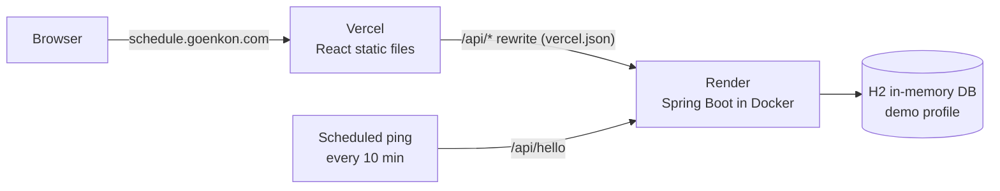

# Staff Scheduling System

**English** · [日本語](README.ja.md) · [中文](README.zh-CN.md)

A full-stack shift-scheduling app for a Japanese yakiniku (BBQ) restaurant. The manager generates a monthly roster, adjusts it by hand, manages staff and handles requests; staff log in to check the roster and submit leave or shift-swap requests.

Built with **React + TypeScript** on the front end and **Java 21 + Spring Boot** on the back end.

## Live demo

**https://schedule.goenkon.com**

| Role | Email | Password |
|---|---|---|
| Manager | `manager@demo.com` | `demo1234` |
| Staff | `staff@demo.com` | `demo1234` |

- The demo back end uses an in-memory database. All data resets to the sample data whenever the server restarts, so feel free to add, edit or delete anything.
- The back end runs on Render's free plan, which sleeps after a period of no traffic. A scheduled job pings it every 10 minutes to keep it awake; if that ping ever stops, the first request can take 30–60 seconds while the back end starts up again.

## Features

**Manager**
- **Dashboard**: staff count, today's shifts, today's leave, total hours this month, pending requests
- **Staff management**: add, edit and delete staff (soft delete — names stay in old rosters and requests)
- **Auto-scheduling**: generate next month's roster for full-time staff (staff per day for kitchen / hall, exclude people); the app first checks whether there are enough people
- **Manual editing**: click a day on the calendar to swap people or add part-timers; edits stay as a draft until the manager submits
- **Requests**: view staff requests and mark them as handled

**Staff**
- View submitted rosters (read-only)
- Submit leave / shift-swap / other requests, and withdraw their own pending ones

**Other**
- Three UI languages: English, Japanese, Chinese
- Role-based access on both sides: the UI hides manager-only actions, and the back end rejects them

## Tech stack

| Layer | Technology |
|---|---|
| Front end | React 19, TypeScript, Vite, MUI, React Router |
| Back end | Java 21, Spring Boot 4, Spring Data JPA (Hibernate), Bean Validation |
| Auth | BCrypt password hashing, JWT (Nimbus JOSE), custom interceptor + `@ManagerOnly` annotation |
| Database | MySQL 8.4 in Docker (local) / H2 in-memory (online demo) |
| Deployment | Vercel (front end), Render + Docker (back end), Cloudflare DNS |

## Architecture



- The front end only calls relative paths (`/api/...`). Locally the Vite dev server proxies them to `localhost:8080`; online, Vercel rewrites them to Render. The browser only ever talks to one origin, so no CORS setup is needed.
- An external scheduled job calls the health-check endpoint `/api/hello` every 10 minutes, so the free Render instance never sits idle long enough to sleep. (`/api/hello` is excluded from login checks for this reason.)

## Design highlights

- **Package by feature** (`employee`, `auth`, `request`, `schedule`), each with the same layers: Entity → Repository → DTO → Service → Controller.
- **Store IDs, not copies**: rosters and requests reference employees by ID, so renaming someone updates everywhere.
- **Nested roster → flat rows**: a month (days → kitchen / hall / part-time → day / evening shift → people) is flattened into `schedule_assignments` rows on save and rebuilt on read, instead of being stored as a JSON blob.
- **No N+1 queries**: `@EntityGraph` loads related data in one query (51 SQL statements → 1).
- **Optimistic locking** with `@Version` on monthly rosters.
- **Trust the token, not the client**: "who am I" always comes from the verified JWT; staff can only withdraw their own pending requests (403 / 409 otherwise).
- **Back-end validation of hard rules**: valid dates, staff in the right department, no one scheduled twice in a shift, part-timers at most one shift per day.
- **Demo profile**: `application-demo.properties` swaps MySQL for in-memory H2 without touching code; seeders recreate staff, accounts, requests and the current month's roster on every start.

## API (15 endpoints)

| Area | Endpoints |
|---|---|
| Auth | `POST /api/auth/login` · `GET /api/auth/me` |
| Employees | `GET /api/employees` · `GET /api/employees/{id}` · `POST /api/employees` · `PUT /api/employees/{id}` · `DELETE /api/employees/{id}` |
| Rosters | `GET /api/schedules?from=YYYY-MM&to=YYYY-MM` · `PUT /api/schedules/{YYYY-MM}` · `DELETE /api/schedules/{YYYY-MM}` |
| Requests | `GET /api/requests/mine` · `GET /api/requests` · `POST /api/requests` · `PATCH /api/requests/{id}/status` · `DELETE /api/requests/{id}` |

Write operations on employees and rosters, and the full request list, are manager-only. Details (tables, fields, status codes) are in [docs/api-design.md](docs/api-design.md) (Chinese).

## Project structure

```
schedule-system/
├── frontend/              React + TypeScript (Vite)
│   ├── src/api/           fetch wrapper (adds the token, handles 401)
│   ├── src/auth/          login state
│   ├── src/data/          API calls + front-end scheduling algorithm
│   ├── src/pages/         Dashboard, Schedule, Employees, Requests, ...
│   ├── src/components/    dialogs and shared components
│   ├── src/i18n/          English / Japanese / Chinese text
│   └── vercel.json        /api rewrite for production
├── backend/               Spring Boot
│   ├── src/main/java/com/goenkon/schedule/
│   │   ├── auth/          accounts, login, JWT, interceptor
│   │   ├── employee/      staff CRUD
│   │   ├── request/       staff requests
│   │   ├── schedule/      monthly rosters
│   │   ├── common/        error handling, interceptor registration
│   │   └── hello/         health check
│   ├── src/main/resources/application*.properties
│   └── Dockerfile
└── docs/                  business rules, API design
```

## Run locally

Requirements: Java 21, Node.js 20+, Docker.

**1. Database (MySQL in Docker)**

```bash
docker run -d --name schedule-mysql \
  -e MYSQL_ROOT_PASSWORD=root1234 -e MYSQL_DATABASE=schedule \
  -e MYSQL_USER=schedule -e MYSQL_PASSWORD=schedule1234 \
  -p 3306:3306 -v schedule-mysql-data:/var/lib/mysql mysql:8.4
```

**2. Back end** (http://localhost:8080)

```bash
cd backend
./mvnw spring-boot:run
```

Tables are created automatically and sample data is inserted on first start.
To skip MySQL and use the in-memory demo database instead:

```bash
SPRING_PROFILES_ACTIVE=demo ./mvnw spring-boot:run
```

**3. Front end** (http://localhost:5173)

```bash
cd frontend
npm install
npm run dev
```

## Deployment

| Part | Where | How |
|---|---|---|
| Front end | Vercel | Root directory `frontend`; `vercel.json` rewrites `/api/*` to the back end |
| Back end | Render (free) | Root directory `backend`, built from the multi-stage `Dockerfile`; `SPRING_PROFILES_ACTIVE=demo`; `JWT_SECRET` set as an environment variable |
| Domain | Cloudflare | CNAME `schedule` → Vercel (DNS only) |

Pushing to `main` redeploys automatically.

## Limitations & next steps

- The auto-scheduling algorithm runs in the browser; the back end only validates the result. A production version would move it to the server.
- The online demo uses an in-memory database by design. For real use: persistent PostgreSQL/MySQL, Flyway migrations, a paid always-on instance, backups.
- Automated tests are the next step (the API has been tested manually with curl).

## Author

Goen Kon — [goenkon.com](https://goenkon.com) · GitHub [@goenkon97](https://github.com/goenkon97)
