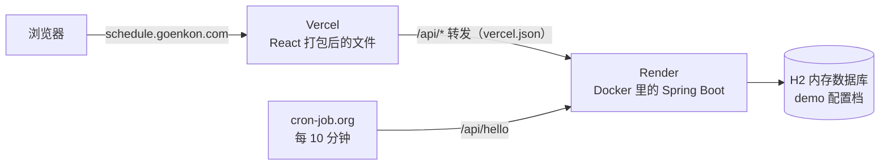

# 烤肉店排班系统（Staff Scheduling System）

[English](README.md) · [日本語](README.ja.md) · **中文**

一家日本烤肉店用的排班系统：店长自动生成每月班表、再手动调整，管理员工、处理员工申请；员工登录后查看班表，提交请假、换班等申请。

前端用 **React + TypeScript**，后端用 **Java 21 + Spring Boot**。

## 在线演示

**https://schedule.goenkon.com**

| 身份 | 账号 | 密码 |
|---|---|---|
| 店长 | `manager@demo.com` | `demo1234` |
| 员工 | `staff@demo.com` | `demo1234` |

- 演示环境的数据库在内存里。服务器每次重启，数据都会恢复成初始的演示数据，可以随便添加、修改、删除。
- 后端部署在 Render 的免费版上，闲置一段时间会睡着，第一个请求可能要等 30～60 秒。

## 功能

**店长**
- **首页**：员工总数、今日排班、今日请假、本月总工时、未处理的申请
- **员工管理**：添加、编辑、删除员工（软删除：旧班表和申请里的名字还在）
- **自动排班**：生成下个月正社员的班表（设定厨房、服务员每天几人，可以排除某些人），生成前先检查人手够不够
- **手动调整**：在月历上点某一天，换人、加兼职；提交之前都是草稿
- **处理申请**：查看员工的申请，标记为已沟通

**员工**
- 查看已提交的班表（只能看）
- 提交请假、换班、其他申请；撤回自己还没处理的申请

**其他**
- 界面支持英语、日语、中文
- 权限前后端都检查：页面上不显示店长专用的操作，后端也会拒绝

## 技术栈

| 层 | 技术 |
|---|---|
| 前端 | React 19、TypeScript、Vite、MUI、React Router |
| 后端 | Java 21、Spring Boot 4、Spring Data JPA（Hibernate）、Bean Validation |
| 登录 | BCrypt 加密密码、JWT（Nimbus JOSE）、自己写的拦截器 + `@ManagerOnly` 注解 |
| 数据库 | MySQL 8.4（本地，Docker）／ H2 内存数据库（在线演示） |
| 部署 | Vercel（前端）、Render + Docker（后端）、Cloudflare DNS |

## 整体结构



- 前端只请求相对路径（`/api/...`）。本地开发时由 Vite 转给 `localhost:8080`，线上由 Vercel 转给 Render。浏览器只跟一个网址打交道，所以不需要处理跨域（CORS）。
- 定时访问健康检查接口，防止免费版的后端睡着。

## 设计要点

- **按功能分包**（`employee`、`auth`、`request`、`schedule`），每个包都是同样的几层：Entity → Repository → DTO → Service → Controller。
- **存编号，不存名字**：班表和申请里存员工的编号，员工改名后，所有地方自动跟着变。
- **嵌套的班表拍平存储**：一个月（每天 → 厨房／服务员／兼职 → 白班／晚班 → 员工）保存时拆成 `schedule_assignments` 表里的一行一行，读取时再组装回去，而不是整个存成 JSON。
- **解决 N+1 查询**：用 `@EntityGraph` 一次查出关联的数据（51 条 SQL → 1 条）。
- **乐观锁**：月班表用 `@Version`。
- **不信前端传来的身份**：「当前是谁」只从验证过的 JWT 里取；员工只能撤回自己的、还没处理的申请（否则 403 / 409）。
- **后端检查硬规则**：日期合法、员工的部门和雇佣形式对得上、同一个班不能排同一个人两次、兼职一天最多一个班。
- **演示配置档**：`application-demo.properties` 不改代码就把 MySQL 换成内存里的 H2；每次启动时由 Seeder 重新放好员工、账号、申请和本月班表。

## 接口（15 个）

| 分类 | 接口 |
|---|---|
| 登录 | `POST /api/auth/login` · `GET /api/auth/me` |
| 员工 | `GET /api/employees` · `GET /api/employees/{id}` · `POST /api/employees` · `PUT /api/employees/{id}` · `DELETE /api/employees/{id}` |
| 班表 | `GET /api/schedules?from=YYYY-MM&to=YYYY-MM` · `PUT /api/schedules/{YYYY-MM}` · `DELETE /api/schedules/{YYYY-MM}` |
| 申请 | `GET /api/requests/mine` · `GET /api/requests` · `POST /api/requests` · `PATCH /api/requests/{id}/status` · `DELETE /api/requests/{id}` |

员工和班表的修改类接口、申请的完整列表，只有店长能用。表结构、字段、状态码的详细说明见 [docs/api-design.md](docs/api-design.md)。

## 目录结构

```
schedule-system/
├── frontend/              React + TypeScript（Vite）
│   ├── src/api/           fetch 的封装（自动带通行证、处理 401）
│   ├── src/auth/          登录状态
│   ├── src/data/          调接口 + 前端的排班算法
│   ├── src/pages/         首页、排班、员工、申请等页面
│   ├── src/components/    弹窗和公共组件
│   ├── src/i18n/          英语、日语、中文的文字
│   └── vercel.json        线上的 /api 转发规则
├── backend/               Spring Boot
│   ├── src/main/java/com/goenkon/schedule/
│   │   ├── auth/          账号、登录、JWT、拦截器
│   │   ├── employee/      员工的增删改查
│   │   ├── request/       员工申请
│   │   ├── schedule/      月班表
│   │   ├── common/        统一错误处理、注册拦截器
│   │   └── hello/         健康检查
│   ├── src/main/resources/application*.properties
│   └── Dockerfile
└── docs/                  业务规则、接口设计
```

## 本地运行

需要：Java 21、Node.js 20 以上、Docker

**1. 数据库（Docker 里的 MySQL）**

```bash
docker run -d --name schedule-mysql \
  -e MYSQL_ROOT_PASSWORD=root1234 -e MYSQL_DATABASE=schedule \
  -e MYSQL_USER=schedule -e MYSQL_PASSWORD=schedule1234 \
  -p 3306:3306 -v schedule-mysql-data:/var/lib/mysql mysql:8.4
```

**2. 后端**（http://localhost:8080）

```bash
cd backend
./mvnw spring-boot:run
```

第一次启动时会自动建表、放入演示数据。
不想用 MySQL 的话，可以用内存数据库启动：

```bash
SPRING_PROFILES_ACTIVE=demo ./mvnw spring-boot:run
```

**3. 前端**（http://localhost:5173）

```bash
cd frontend
npm install
npm run dev
```

## 部署

| 部分 | 放在哪 | 怎么做 |
|---|---|---|
| 前端 | Vercel | Root Directory 选 `frontend`；`vercel.json` 把 `/api/*` 转给后端 |
| 后端 | Render（免费版） | Root Directory 选 `backend`，用两阶段的 `Dockerfile` 打包；`SPRING_PROFILES_ACTIVE=demo`；`JWT_SECRET` 设成环境变量 |
| 域名 | Cloudflare | CNAME `schedule` → Vercel（DNS only） |

推到 `main` 分支后会自动部署。

## 现在的限制和下一步

- 自动排班的算法在浏览器里运行，后端只检查结果。正式产品会把算法移到后端。
- 在线演示是故意用内存数据库的。真正给店用的话，需要换成存在硬盘上的 PostgreSQL / MySQL，用 Flyway 管理表结构变更，换成不会休眠的付费实例，并定期备份。
- 下一步是加自动化测试（现在接口是用 curl 手动测的）。

## 作者

Goen Kon — [goenkon.com](https://goenkon.com) · GitHub [@goenkon97](https://github.com/goenkon97)
